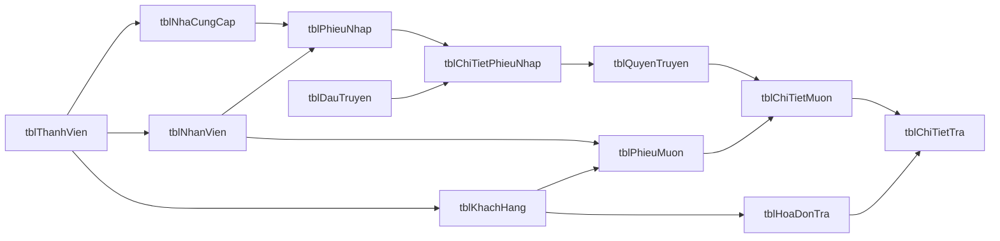

# M3 P2 — Mô hình dữ liệu và dữ liệu mẫu

## Phạm vi

Lược đồ gồm 18 bảng nghiệp vụ theo mô hình trong báo cáo, hiện được quản lí qua sáu migration Flyway. Phần mượn/trả có trong CSDL để lưu nguồn dữ liệu cho thống kê NCC; P2 chưa triển khai giao diện hoặc nghiệp vụ mượn/trả. `app_seed_history` chỉ đánh dấu seed demo đã chạy, không phải bảng nghiệp vụ. `flyway_schema_history` do Flyway tự quản lý.



Đường truy nguồn NCC cho một khoản thuê là `tblChiTietTra → tblChiTietMuon → tblQuyenTruyen → tblChiTietPhieuNhap → tblPhieuNhap → tblNhaCungCap`. Không gắn NCC trực tiếp lên đầu truyện vì cùng một đầu truyện có thể được nhập từ nhiều NCC.

## Từ điển bảng

| Bảng | Vai trò | Khóa/quan hệ chính |
|---|---|---|
| `tblThanhVien` | Tài khoản nội bộ kế thừa trong mô hình thành viên | `id` PK; `tenDangNhap` duy nhất |
| `tblNhanVien` | Hồ sơ nhân viên | `id` PK/FK → thành viên; `maNhanVien` duy nhất |
| `tblNhaCungCap` | Thông tin NCC | `id` PK/FK → thành viên; mã, điện thoại chuẩn và email chuẩn duy nhất; `version` phục vụ kiểm soát sửa đồng thời |
| `tblKhachHang` | Hồ sơ khách hàng trong dữ liệu mượn/trả | `id` PK/FK → thành viên; `maKhachHang` duy nhất |
| `tblDauTruyen` | Thông tin đầu truyện | `id` PK; `maDauTruyen` và `naturalKey` duy nhất |
| `tblPhieuNhap` | Phiếu nhập của một NCC do một nhân viên lập | `id` PK; FK → nhân viên, NCC; mã duy nhất |
| `tblChiTietPhieuNhap` | Dòng nhập đầu truyện, số lượng và hai mức giá tại lúc nhập | `id` PK; FK → phiếu nhập, đầu truyện; khóa duy nhất chặn dòng trùng cùng phiếu/đầu truyện/giá nhập/giá thuê; service sẽ cộng số lượng vào dòng cũ |
| `tblQuyenTruyen` | Một quyển vật lý có nguồn nhập xác định | `id` PK; FK kép tới dòng nhập và cùng đầu truyện; `maQuyenTruyen` duy nhất |
| `tblPhieuMuon` | Phiếu mượn của khách hàng do nhân viên lập | `id` PK; FK → nhân viên, khách hàng; mã duy nhất |
| `tblChiTietMuon` | Một lần mượn một quyển vật lý và giá thuê chụp tại lúc mượn | `id` PK; FK → phiếu mượn, quyển; số lượng bắt buộc bằng 1 |
| `tblHoaDonTra` | Hóa đơn ghi nhận lượt trả của khách hàng | `id` PK; FK → nhân viên, khách hàng; mã duy nhất |
| `tblChiTietTra` | Một quyển được trả trong hóa đơn | `chiTietMuonId` PK/FK → chi tiết mượn nên mỗi chi tiết mượn có tối đa một lần trả; FK → hóa đơn trả |
| `tblTaiSanCoc` | Danh mục tài sản có thể nhận làm cọc | `id` PK |
| `tblCTTaiSanCoc` | Tài sản cọc cụ thể nhận trong một phiếu mượn | `id` PK; FK → danh mục tài sản, phiếu mượn |
| `tblTaiSanTra` | Lần trả tài sản cọc | `ctTaiSanCocId` PK/FK → tài sản cọc đã nhận; FK → hóa đơn trả |
| `tblLoi` | Danh mục lỗi và mức phạt mặc định | `id` PK |
| `tblLoiMuon` | Lỗi ghi nhận lúc cho mượn, giữ tên/mô tả chụp tại giao dịch | `id` PK; FK → chi tiết mượn, danh mục lỗi; mỗi lỗi danh mục tối đa một lần trên một chi tiết |
| `tblLoiTra` | Lỗi ghi nhận lúc trả, giữ tên/mô tả chụp tại giao dịch | `id` PK; FK → chi tiết trả, danh mục lỗi; cho phép nhiều lỗi trên một chi tiết trả |

### Các cột

- `tblThanhVien`: `id BIGINT`, `tenDangNhap VARCHAR(120)`, `matKhauHash VARCHAR(255)`.
- `tblNhanVien`: `id BIGINT`, `maNhanVien VARCHAR(16)`, `hoTen VARCHAR(255)`, `chucVu VARCHAR(100)`.
- `tblNhaCungCap`: `id BIGINT`, `maNCC VARCHAR(16)`, `tenNCC VARCHAR(255)`, `diaChi VARCHAR(500)`, `soDienThoai VARCHAR(16)`, `soDienThoaiChuan VARCHAR(15)`, `email VARCHAR(254)`, `emailChuan VARCHAR(254)`, `version BIGINT`.
- `tblKhachHang`: `id BIGINT`, `maKhachHang VARCHAR(16)`, `ten VARCHAR(255)`, `diaChi VARCHAR(500)`, `soDienThoai VARCHAR(16)`.
- `tblDauTruyen`: `id BIGINT`, `maDauTruyen VARCHAR(16)`, `tenDauTruyen/tacGia/theLoai/nhaXuatBan VARCHAR(255)`, `namXuatBan SMALLINT NULL`, bốn trường chuẩn hóa tương ứng, `namXuatBanChuan SMALLINT`, `naturalKey CHAR(64)`.
- `tblPhieuNhap`: `id BIGINT`, `maPhieuNhap VARCHAR(16)`, `ngayLap DATE`, `nhanVienId BIGINT`, `nhaCungCapId BIGINT`, `requestKey CHAR(36) NULL` duy nhất khi có giá trị, dùng chống lưu lặp phiếu nhập.
- `tblChiTietPhieuNhap`: `id BIGINT`, `phieuNhapId BIGINT`, `dauTruyenId BIGINT`, `soLuong INT`, `donGiaNhap DECIMAL(12,0)`, `giaThueNgay DECIMAL(12,0)`.
- `tblQuyenTruyen`: `id BIGINT`, `maQuyenTruyen VARCHAR(16)`, `giaThue DECIMAL(12,0)`, `chiTietPhieuNhapId BIGINT`, `dauTruyenId BIGINT`.
- `tblPhieuMuon`: `id BIGINT`, `maPhieuMuon VARCHAR(16)`, `ngayMuon DATE`, `nhanVienId BIGINT`, `khachHangId BIGINT`.
- `tblChiTietMuon`: `id BIGINT`, `phieuMuonId BIGINT`, `quyenTruyenId BIGINT`, `donGia DECIMAL(12,0)`, `soLuong TINYINT`, `tinhTrangMuon VARCHAR(255)`.
- `tblHoaDonTra`: `id BIGINT`, `maHoaDonTra VARCHAR(16)`, `ngayLap DATE`, `nhanVienId BIGINT`, `khachHangId BIGINT`.
- `tblChiTietTra`: `chiTietMuonId BIGINT`, `hoaDonTraId BIGINT`, `ngayTra DATE`, `tinhTrangTra VARCHAR(255)`.
- `tblTaiSanCoc`: `id BIGINT`, `moTa VARCHAR(500)`, `giaTriUocTinh DECIMAL(12,0)`, `ten VARCHAR(255)`.
- `tblCTTaiSanCoc`: `id BIGINT`, `giaTri DECIMAL(12,0)`, `tinhTrang VARCHAR(255)`, `daTra BOOLEAN`, `taiSanCocId BIGINT`, `phieuMuonId BIGINT`.
- `tblTaiSanTra`: `ctTaiSanCocId BIGINT`, `hoaDonTraId BIGINT`, `ngayTra DATE`, `tinhTrangTra VARCHAR(255)`.
- `tblLoi`: `id BIGINT`, `ten VARCHAR(255)`, `moTa VARCHAR(500)`, `tienPhat DECIMAL(12,0)`.
- `tblLoiMuon`: `id BIGINT`, `chiTietMuonId BIGINT`, `loiId BIGINT`, `ten VARCHAR(255)`, `moTa VARCHAR(500)`.
- `tblLoiTra`: `id BIGINT`, `chiTietTraId BIGINT`, `loiId BIGINT`, `ten VARCHAR(255)`, `moTa VARCHAR(500)`.

Các cột mã trong bảng nghiệp vụ là `VARCHAR(16)` và có chỉ mục duy nhất. `id` là khóa số nội bộ; mã nghiệp vụ có tiền tố `NV`, `NCC`, `KH`, `DT`, `QT`, `PN`, `PM`, `HDT` nối với `id` đệm tối thiểu sáu chữ số. Mã không nên đổi sau khi tạo.

## Quy tắc và giới hạn dữ liệu

- Tiền là VND nguyên, dùng `DECIMAL(12,0)`; giá thuê/giá nhập dương. Phạt và giá trị cọc cho phép 0 theo các ràng buộc của bảng.
- Số lượng một dòng nhập từ 1 đến 10.000. Chi tiết mượn đại diện đúng một quyển vật lý (`soLuong = 1`).
- Tên người/đầu truyện tối đa 255 ký tự; địa chỉ 500; email 254. Năm xuất bản có thể trống; khi có phải từ 1 trở lên, và phần mềm phải từ chối năm sau năm hiện tại.
- Điện thoại cho phép 10–15 chữ số, có thể có `+` ở đầu; giá trị chuẩn bỏ dấu `+`. Điện thoại chuẩn và email chuẩn của NCC có ràng buộc duy nhất. Email chuẩn được chuẩn hóa Unicode, bỏ khoảng trắng biên/gộp khoảng trắng và chuyển chữ thường.
- Tên đầu truyện được chuẩn hóa NFC, bỏ khoảng trắng biên, gộp chuỗi khoảng trắng và chuyển chữ thường; không bỏ dấu tiếng Việt. Khóa tự nhiên gồm tên, tác giả, thể loại, nhà xuất bản và năm; năm `NULL` bằng nhau khi so trùng. Ứng dụng phải so sánh đủ các giá trị chuẩn hóa; `naturalKey` SHA-256 là chỉ mục duy nhất hỗ trợ phát hiện đồng thời.
- Xóa/thay khóa của bản ghi đã được tham chiếu bị chặn bằng khóa ngoại `RESTRICT`.
- Ngày trả phải không trước ngày mượn; ngày lập hóa đơn trả phải không trước ngày trả. Hai ràng buộc phụ thuộc nhiều bảng, vì vậy lớp service phải kiểm tra trước khi ghi; schema hiện không dùng trigger để áp đặt hai quy tắc này.
- Mã nghiệp vụ được sinh từ ID sau khi insert. Với bảng có ID tự tăng, thao tác insert, sinh mã, cập nhật mã phải nằm trong cùng transaction. Cột mã tạm cho phép `NULL` để hỗ trợ bước sinh ID; lớp service phải bảo đảm không commit bản ghi thiếu mã.
- NCC và khách hàng có hàng kế thừa trong `tblThanhVien` theo mô hình dữ liệu; P2 cấp username nội bộ và mật khẩu ngẫu nhiên đã băm cho các bản demo này. Chỉ tài khoản demo nhân viên `a` dùng mật khẩu cục bộ trong `web/.env`; P2 chưa cung cấp luồng đăng nhập cho NCC/khách hàng.
- Giá thuê chụp tại lúc mượn nằm ở `tblChiTietMuon.donGia`; thay đổi giá hiện hành không làm thay đổi giao dịch lịch sử.

Các giới hạn cần kiểm tra ở lớp service khi ghi gồm độ dài tổng dòng/phiếu không vượt `999999999999` VND, năm xuất bản không vượt năm hiện tại và thứ tự ngày liên bảng. Mỗi cột tiền được giới hạn trong `DECIMAL(12,0)`; tổng nhiều dòng cần được kiểm tra trước khi lưu hoặc hiển thị.

## Seed demo và số liệu kỳ vọng

V5 bổ sung CHECK chặn email/email chuẩn rỗng và thành tiền một dòng nhập vượt `999999999999` VND. V6 thêm `requestKey` duy nhất cho phiếu nhập để xử lý gửi lại yêu cầu lưu. Giới hạn tổng phiếu và các phép tổng hợp nhiều dòng vẫn cần kiểm tra tại service. Kết quả nghiệm thu schema và dữ liệu mẫu được ghi trong [phase2-review.md](phase2-review.md).

Seed tạo ba NCC, hai đầu truyện, hai phiếu nhập và bốn quyển vật lý. Cùng đầu truyện `Doraemon Tập 1` được nhập từ NCC 101 và 102. Một hóa đơn trả (`HDT000001`) có hai quyển từ hai NCC. Quyển `QT000001` được mượn nhiều lần với hai giá chụp khác nhau (10.000 và 12.000 VND). NCC 103 không có giao dịch trả.

Doanh thu của từng chi tiết trả là `gia thuê chụp lúc mượn × max(1, số ngày lịch giữa ngày mượn và ngày trả)`. Lọc khoảng ngày dùng `tblHoaDonTra.ngayLap` với hai đầu mút bao gồm; chỉ NCC có doanh thu xuất hiện. Tiền phạt và tài sản cọc không được cộng vào doanh thu.

| Khoảng ngày lập hóa đơn trả | NCC | Doanh thu kỳ vọng |
|---|---|---:|
| 01/01/2025–31/01/2025 | NCC 101 — Tuổi Trẻ | 37.000 VND |
| 01/01/2025–31/01/2025 | NCC 102 — Kim Đồng | 30.000 VND |
| 03/01/2025–03/01/2025 | NCC 101 — Tuổi Trẻ | 20.000 VND |
| 03/01/2025–03/01/2025 | NCC 102 — Kim Đồng | 30.000 VND |
| 01/02/2025–01/02/2025 | NCC 102 — Kim Đồng | 15.000 VND |

Ví dụ tính tay cho tháng 01: NCC 101 = `10.000 × 2 + 12.000 × 1 + 5.000 × 1 = 37.000`; NCC 102 = `15.000 × 2 = 30.000`. Hóa đơn ngày 03/01 có hai NCC, vì vậy phần tiền của từng NCC được phân theo quyển có nguồn nhập tương ứng.

## Tạo schema, seed và xác minh

Từ thư mục `web`, cấu hình `.env` theo `.env.example`, sau đó:

```powershell
docker compose up --build -d
docker compose --profile tools run --rm db-tools -Pdb-tools flyway:migrate
docker compose --profile tools run --rm db-tools -Pdb-tools compile exec:java@seed-demo -q
docker compose --profile tools run --rm db-tools -Pdb-tools compile exec:java@verify-schema -q
```

Seed dùng `DEMO_PASSWORD` cho `a`, chỉ chạy một lần theo marker `m3-demo-v1`; chạy lại không thay đổi dữ liệu. Verifier xác nhận sáu migration, 18 bảng nghiệp vụ, mã và khóa chuẩn hóa, đường truy nguồn, thứ tự ngày, giá lịch sử, lỗi/cọc mẫu và các tổng doanh thu trong bảng trên. Không dùng `docker compose down -v` trên dữ liệu cần giữ.
